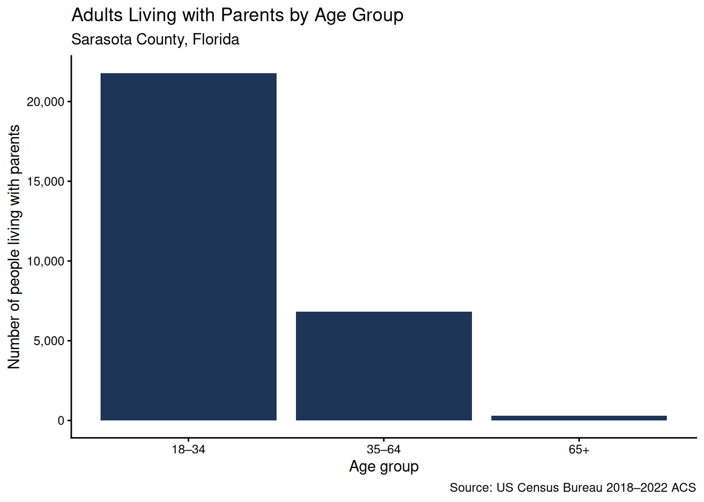
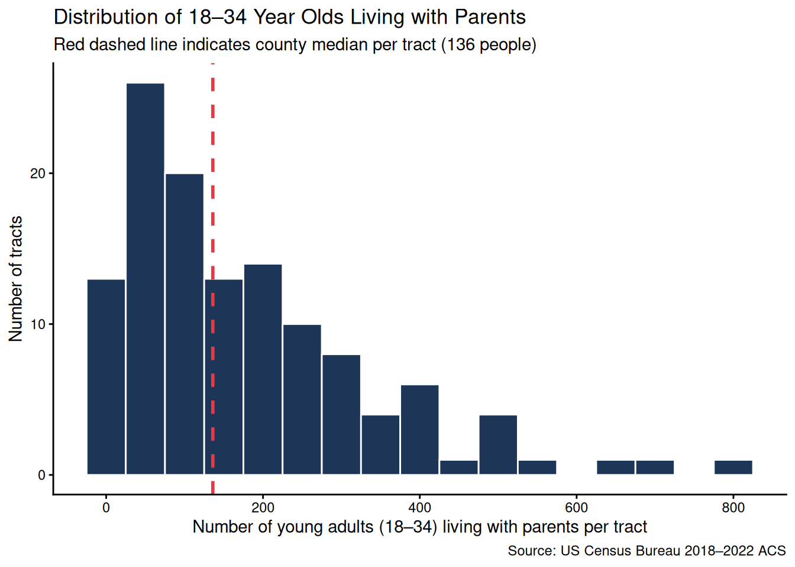
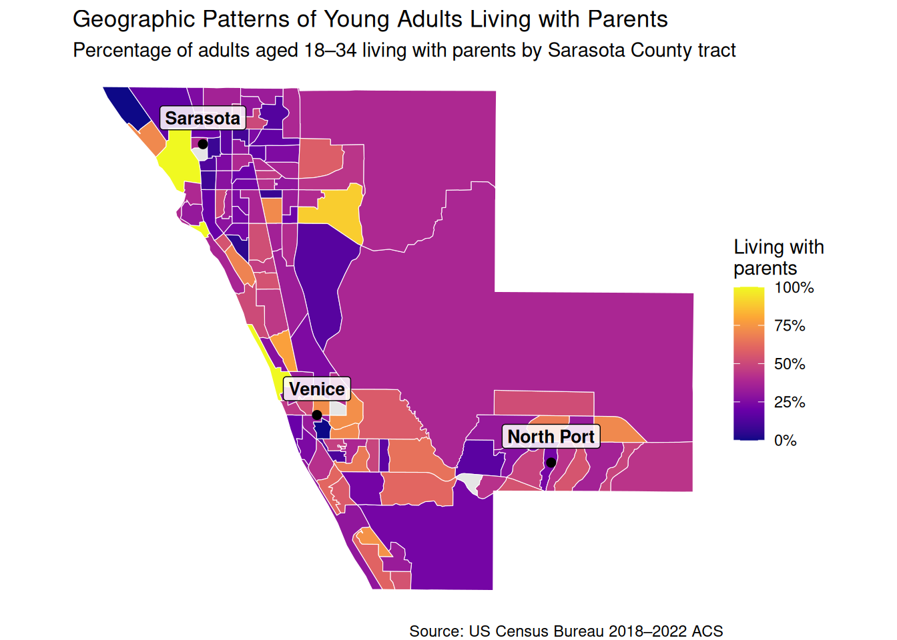
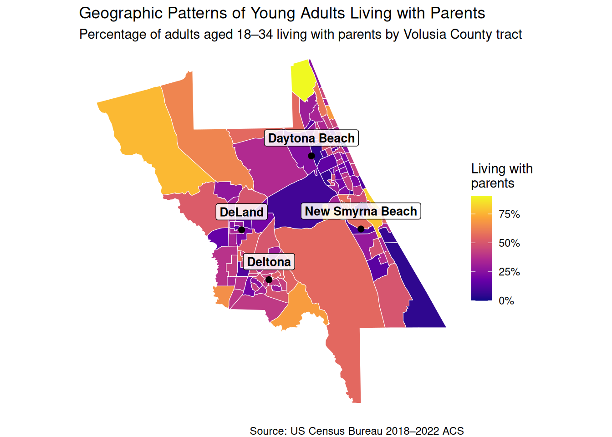
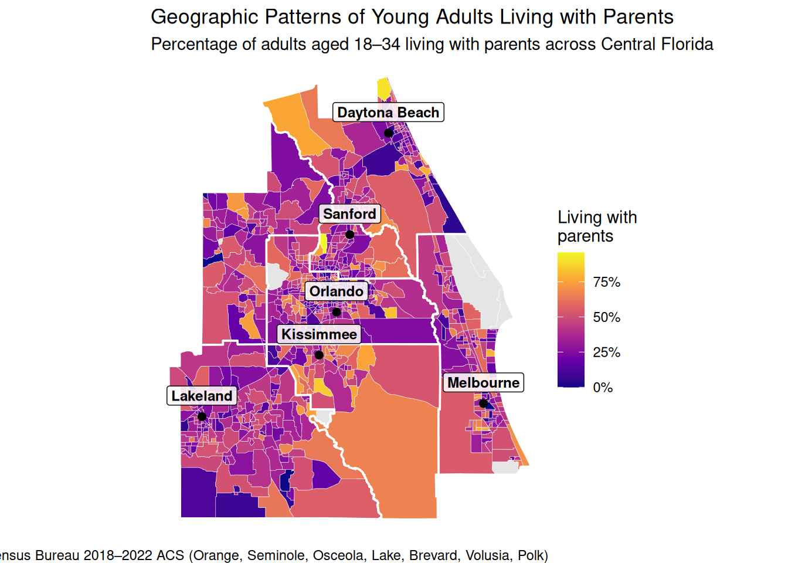
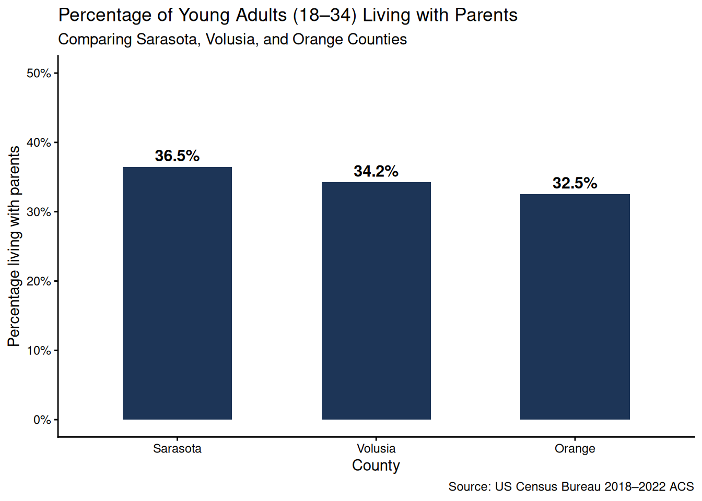

::: {.cell}

:::

::: {.cell}
::: {.cell-output-display}
{width=672}
:::
:::

::: {.cell}
::: {.cell-output-display}
{width=672}
:::
:::

::: {.cell}
::: {.cell-output-display}
{width=672}
:::
:::

::: {.cell}
::: {.cell-output-display}
{width=672}
:::
:::

::: {.cell}
::: {.cell-output-display}
{width=672}
:::
:::

## Comparing Sarasota, Volusia, and Orange Counties

::: {.cell}
::: {.cell-output-display}
{width=672}
:::
:::

Among these three counties, **Sarasota** has the highest share of young adults living with parents (**36.5%**), followed by **Volusia** (**34.2%**), while **Orange County** has the lowest (**32.5%**).

Several key factors likely drive these differences:

- **College Enrollment & Student Rentals:** Orange County is home to the University of Central Florida (UCF), which enrolls over 68,000 students. Many students and recent graduates live in dense student apartments, off-campus shared housing, and dorms around eastern Orlando as roommates rather than living at home with parents.
- **Housing Costs & Retiree-Heavy Demographics:** Sarasota is an affluent coastal county with a high median age and steep housing and rental prices. For young adults entering the local workforce, high cost of living makes independent renting significantly more challenging.
- **Urban Density vs. Suburban/Coastal Communities:** Orange County's dense urban core provides a broader inventory of multi-family apartments and starter rental units compared to the single-family and retirement-oriented neighborhoods common in Sarasota and Volusia.

## Why Does Osceola County Have the Highest Rate in the Region?

Across all of Central Florida, **Osceola County** stands out with nearly half (**47.9%**) of young adults living with parents—the highest rate in the region. 

Why is Osceola so high?

1. **Multigenerational Family Norms:** Osceola County has a majority Hispanic population (56.1%). In Hispanic cultures, multigenerational living and young adults remaining in the family home until marriage or financial stability is culturally valued and common.
2. **Tourism & Service-Sector Wages:** Much of Osceola's economy is tied to the hospitality and service industries supporting the Kissimmee and Walt Disney World corridor. Because these positions often pay entry-level wages while regional rent prices have surged, young workers are often financially priced out of independent living.
3. **Absence of a Large Residential University Influx:** Unlike Orange County, Osceola does not have a massive residential university drawing tens of thousands of independent young adult renters from outside the area.

